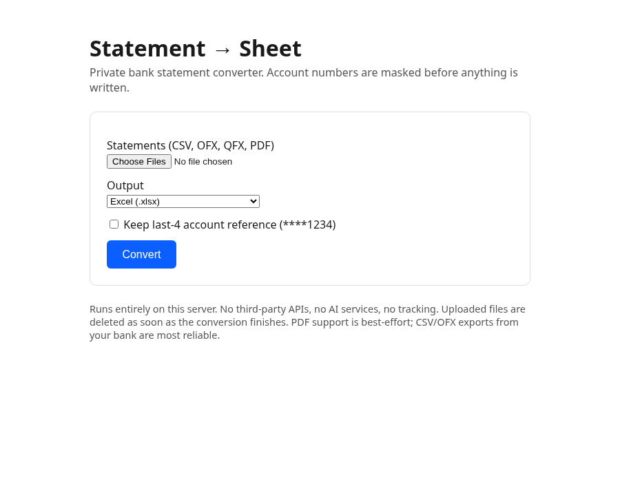

# Statement → Sheet

**Private bank statement converter.** Turn bank statements (CSV, OFX/QFX, or PDF) into clean Excel or CSV spreadsheets. Account numbers are masked **before** anything is written. Runs entirely on your own machine or server: no external APIs, no AI services, no tracking, no data sharing.

Built for freelancers, small businesses, bookkeepers, and tax preparers who want tidy transaction data without handing financial records to a third party.



## Features

- Upload one or more statements in the browser, download a spreadsheet: done
- Inputs: **CSV**, **OFX/QFX**, **PDF** (best-effort)
- Outputs: **XLSX**, **CSV**, or a **ZIP** with both plus a redaction report
- Account numbers, card numbers, and IBANs are masked automatically (optional `****1234` last-4 reference)
- Uploaded files are processed in a temporary folder and **deleted as soon as the conversion finishes**
- Also usable as a command-line tool for batch jobs

## Privacy

- Zero outbound network calls. The app only talks to the browser that uploads to it.
- Full account numbers never appear in intermediate or output files. By default there is **no** account column at all.
- The redaction report lists *counts* of masked patterns, never the raw values.
- Nothing is stored: no database, no logs of file contents. Docker Compose mounts `/tmp` as tmpfs and runs the container read-only as a non-root user.
- Self-host it behind HTTPS if you expose it beyond your own network.

## Quick start (Docker)

```bash
git clone https://github.com/Stellar7070/statement-to-sheet.git
cd statement-to-sheet
docker compose up -d --build
```

Open http://localhost:8000.

| Env var | Default | Meaning |
|---------|---------|---------|
| `PORT` | `8000` | Port the web app listens on |
| `MAX_UPLOAD_MB` | `20` | Max size per uploaded file |

Health check endpoint: `GET /health` returns `{"status": "ok"}`.

## Deploy to Hostinger

<!-- Deploy to Hostinger button goes here once available. -->
_One-click deploy button coming soon._ Until then, deploy on any Docker-capable VPS with the Docker Compose steps above.

## Python setup (no Docker)

Requires Python 3.10+.

```bash
git clone https://github.com/Stellar7070/statement-to-sheet.git
cd statement-to-sheet
python3 -m venv .venv
source .venv/bin/activate
pip install -e .
```

Run the web app:

```bash
statement-to-sheet-web            # http://localhost:8000 (set PORT to change)
```

## Command-line usage

```bash
# single file
statement-to-sheet path/to/statement.csv --out out/mydir

# folder of CSV / OFX / QFX / PDF statements
statement-to-sheet path/to/folder --out out/mydir

# keep last-4 account refs only (****1234)
statement-to-sheet path/to/statement.csv --out out/mydir --keep-account-ref
```

Outputs:

| File | Contents |
|------|----------|
| `transactions.csv` | date, description, amount, type, balance, source_file, currency |
| `transactions.xlsx` | Same data in Excel format |
| `REDACTION_REPORT.txt` | Counts of account-like patterns masked |

### Try it with the synthetic sample

The `sample/` folder contains **fake** statements only (no real data):

```bash
statement-to-sheet sample --out out/sample
```

## Tips

Banks usually offer **CSV** or **OFX/QFX** downloads; those are the most reliable. **PDF is best-effort**: layouts vary and text extraction (via `pdfplumber`) can miss rows. If PDF results look off, re-export as CSV/OFX.

## Development

```bash
pip install -e '.[test]'
pytest
```

## License

[MIT](LICENSE) © 2026 E K / AI Ready Hub
